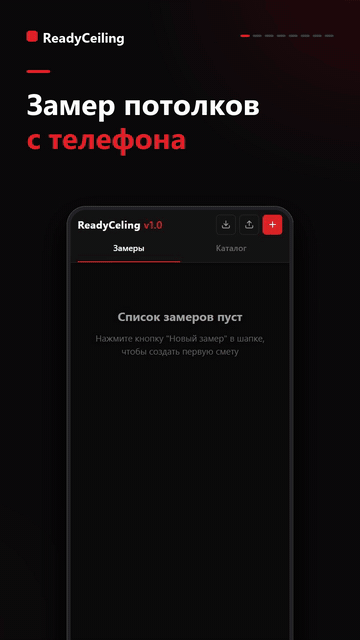

  

<h1 align="center">ReadyCeiling</h1>

  <b>Замер натяжного потолка и смета для клиента — прямо с телефона, даже без интернета.</b>

  

Мастер рисует комнату на экране, вводит длины стен, выбирает позиции из своего прайса и отправляет клиенту готовую смету в PDF.

> Исходный код закрыт. Здесь — описание продукта.

## Что умеет

- ✏️ **Чертёж комнаты на холсте:** рисование пальцем, зум и панорамирование
- 📏 **Умный ввод стен:** контур остаётся замкнутым при изменении длин, пошаговый режим проводит по всем стенам
- 🧮 **Автоматический расчёт** площади и периметра
- 📚 **Свой прайс-каталог:** изменение цен не затрагивает уже составленные сметы
- 📄 **Смета в PDF** в двух вариантах: для экрана и для печати
- 📤 **Отправка клиенту:** PDF или текст в WhatsApp и Telegram
- 📴 **Работает офлайн:** устанавливается как приложение (PWA)
- 💾 **Данные остаются на устройстве,** есть резервная копия в JSON

## Стек

React · TypeScript · Vite · SVG · @react-pdf/renderer · PWA · CSS Modules · Netlify

## Инженерные задачи

- **Геометрия:** выравнивание нарисованного контура и перебалансировка стен
- **Интерфейс для телефона:** жесты на холсте, нижняя шторка, числовой ввод
- **Производительность:** тяжёлый PDF-модуль (~1,2 МБ) загружается только по требованию
